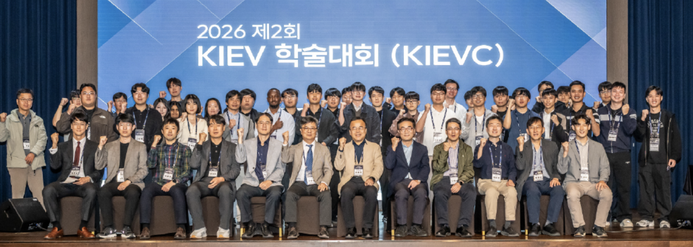

We participated in the **2026 Autumn Conference of the Korean Institute of Electric Vehicles (KIEV)** held at the *Sol beach* in **Samcheok, South Korea**, from **October 14 to 16, 2026**.

Seunghun Jang presented a paper at the conference titled: <a href="{{site.url}}/publications/2026-V2X/">**V2X-Based Predictive Thermal Management for Battery Electric Vehicles**</a>.

Moreover, Prof. Kyunghwan Choi presented a tutorial at the conference titled: <a href="/talks/#ICCAS2026Tutorial">**Model Predictive Control as Online Policy Improvement: A Reinforcement Learning Perspective**</a>.

