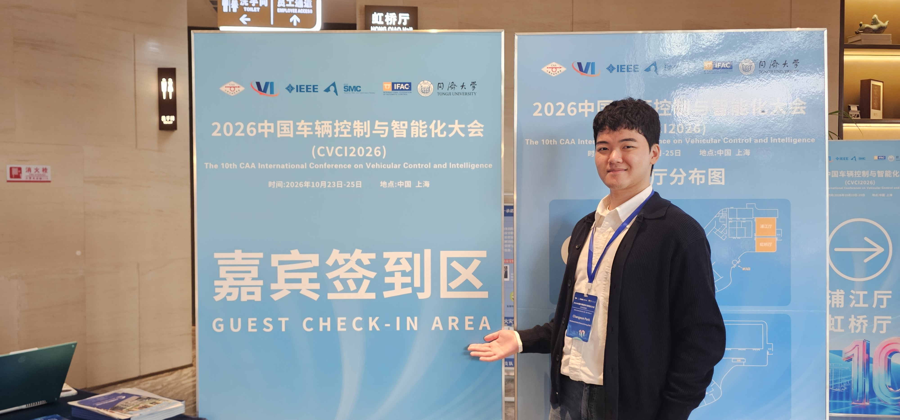
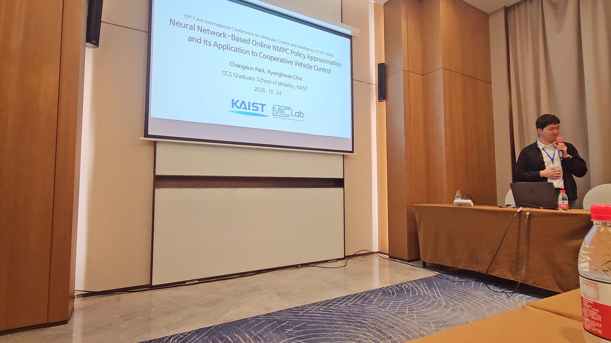

Integrated M.S./Ph.D. student <a href="{{site.url}}/members/cePark/">**Changeun Park**</a> participated in the **2026 CAA CVCI** held at the *Auto City Ruili Hotel* in **Shanghai, China**, from **October 23 to 25, 2026**.

He presented a paper at the conference titled: **Neural Network-Based Online NMPC Policy Approximation and its Application to Cooperative Vehicle Control**.

