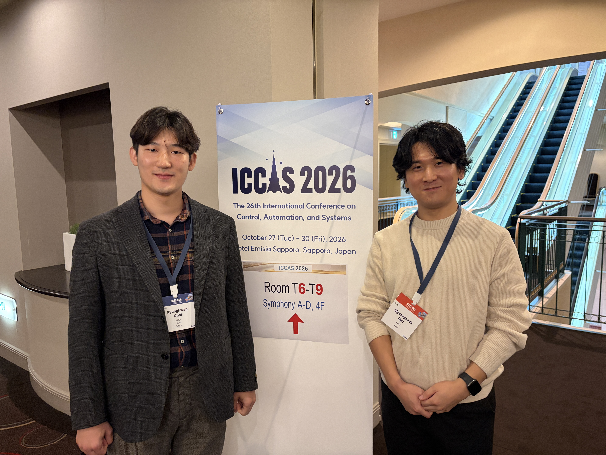

We, <a href="{{site.url}}/members/msRyu/">**Myeongseok Ryu**</a>, and Prof. <a href="{{site.url}}/members/khChoi/">**Kyunghwan Choi**</a>, participated in the **2026 IEEE ICCAS** held at the *Hotel Emisia Sapporo* in **Sapporo, Japan**, from **October 27 to 30, 2026**.

Myeongseok Ryu presented a paper at the conference titled: <a href="{{site.url}}/publications/2026-constrained-optimization-based-yaw-rate-reference/">**Constrained Optimization-Based Yaw-Rate Reference Map Generation for Active Rear Steering Control of Four-Wheel-Steering Vehicles**</a>.

Moreover, Prof. Kyunghwan Choi presented a invited talk at the conference titled: <a href="/talks/#KIEVC2026Tutorial">**xEV Energy Management: From Vehicle Control to Network Intelligence**</a>.

