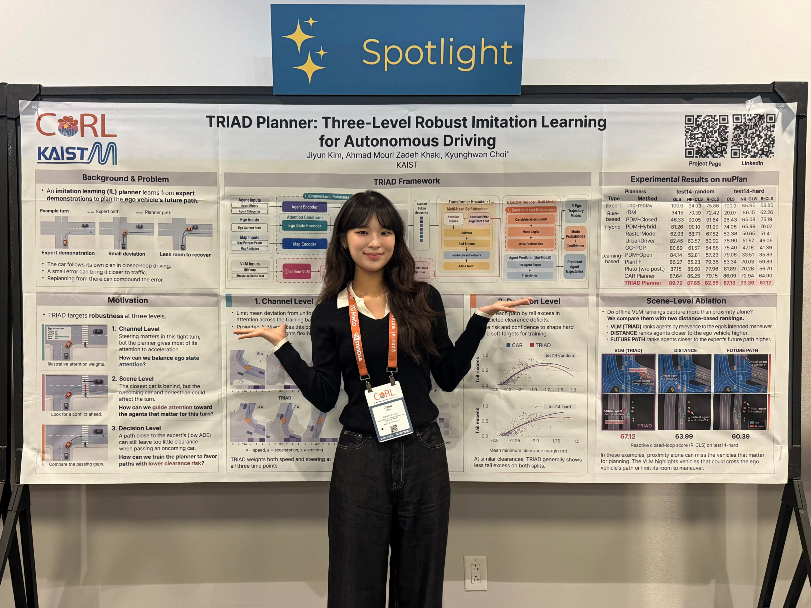
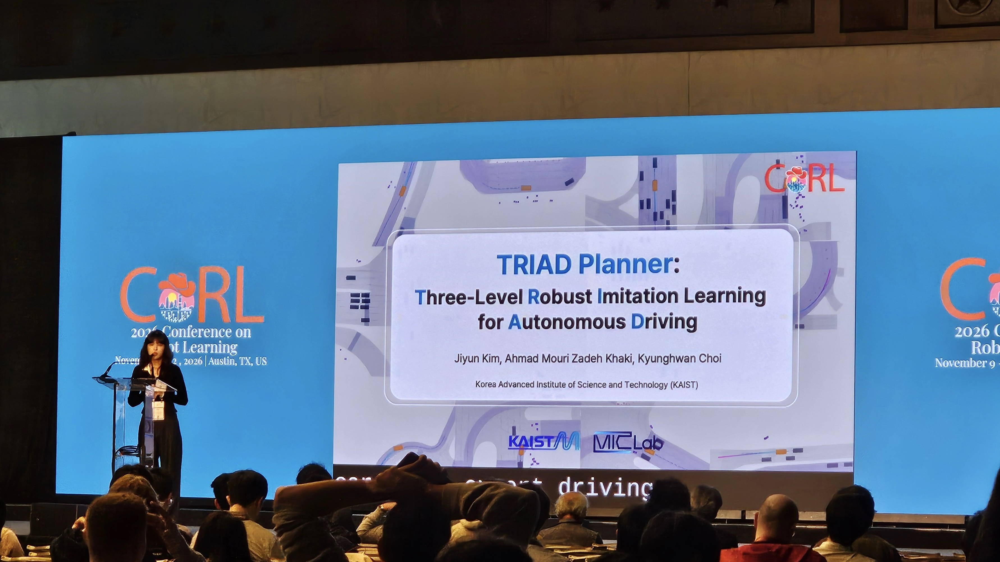

Jiyun Kim participated in the **2026 Conference on Robot Learning (CoRL)** held in **Austin, Texas, USA**, from **November 9 to 12, 2026**.

  

Jiyun presented her paper titled: **“TRIAD Planner: Three-Level Robust Imitation Learning for Autonomous Driving”** as a **Spotlight Presentation**, selected from the **top 3.4% of active submissions**.

  

<a href="https://jixyuxn.github.io/">The live presentation can be viewed here.</a>

